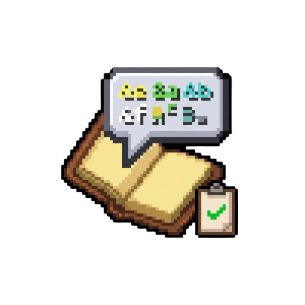
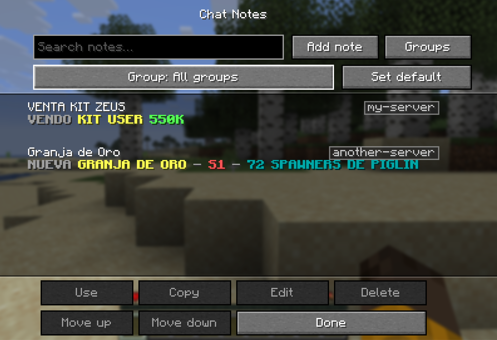
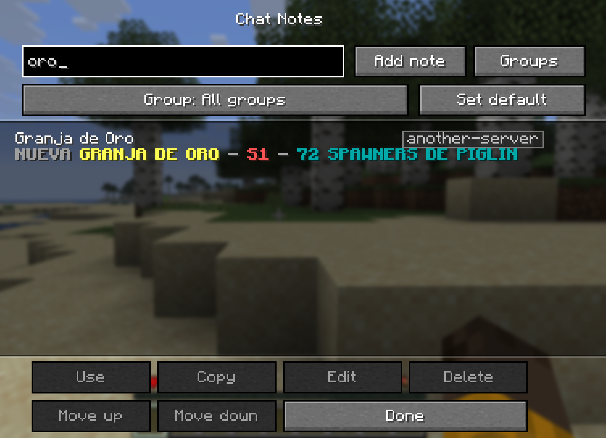
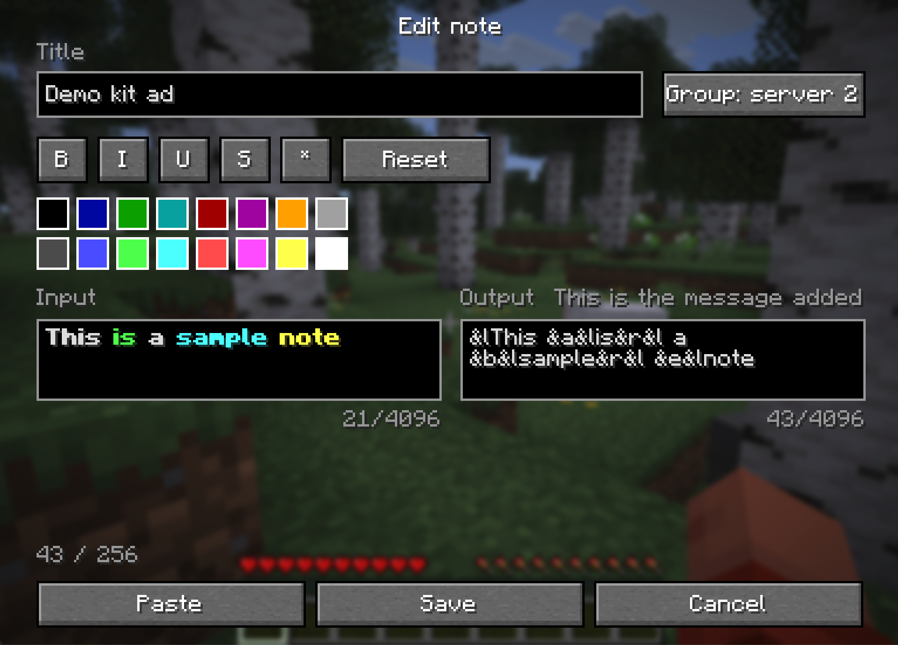
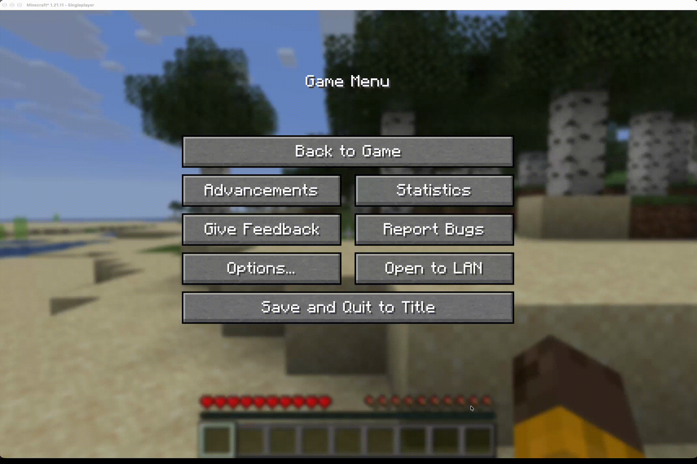
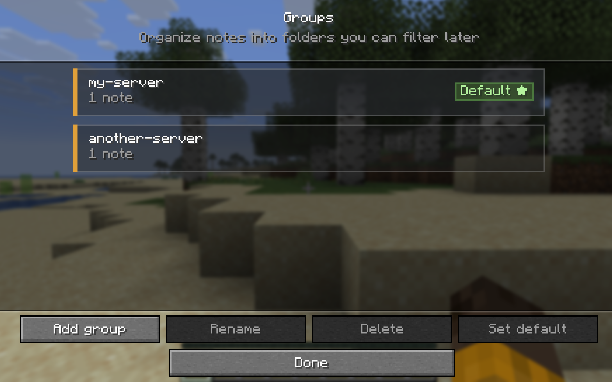
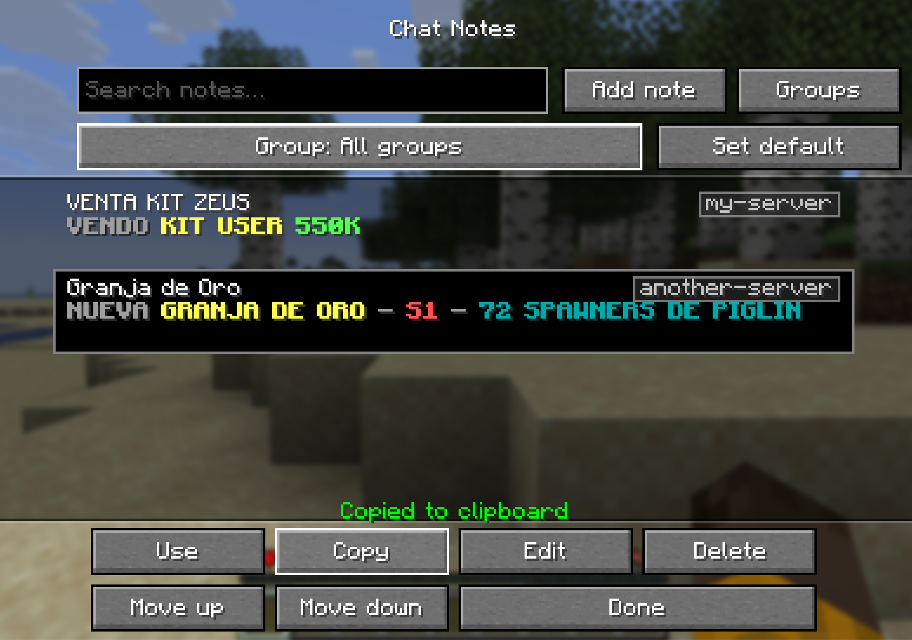

# Chat Notes

<p align="center">
  
</p>

<p align="center">
  <strong>Personal chat snippet library for Fabric</strong> — save <code>&</code>-coloured messages, copy them, or drop them into chat without auto-sending.
</p>

A client-only Fabric mod for Minecraft **1.21.11**. It keeps a personal library of chat snippets (typically messages with `&`-style color codes generated elsewhere) so you can **Copy** one to the system clipboard or **Use** it, which opens the chat box with the text already filled in, ready for you to review and send.

The mod never needs to be installed on a server, sends nothing over the network by itself, and never modifies the text you stored.

## Status

Phase 5 groups in progress: single-level folders with filter, create/rename/delete, and per-note group assignment. See [plans/](plans) for the full roadmap.

## Screenshots

Capture guide and exact filenames: [media/screenshots/SCREENSHOTS.md](media/screenshots/SCREENSHOTS.md).

| Notes list |
|:---:|
|  |

| Search / group filter |
|:---:|
|  |

| Note editor |
|:---:|
|  |

| Use → chat pre-filled |
|:---:|
|  |

| Groups |
|:---:|
|  |

| Copy |
|:---:|
|  |

## Store listing

Ready-to-paste Modrinth / CurseForge / GitHub blurb (EN + ES): [media/STORE_DESCRIPTION.md](media/STORE_DESCRIPTION.md).

**One-liner:** Personal library of chat snippets for Fabric — save `&`-coloured messages, copy them, or drop them into chat without auto-sending.

## Features

- **Use** / **Copy** without auto-send  
- Add, edit, delete, reorder, search  
- Groups + default filter  
- Coloured `&` / hex preview in the UI  
- Global storage (`config/chatnotes/notes.json`) across all worlds/servers on that install  
- UI languages: English, Español (México), Español (España)

## Toolchain

These are the exact versions the project is built against. Check [fabricmc.net/develop](https://fabricmc.net/develop) before bumping any of them.

- Minecraft `1.21.11` — Fabric Loader `0.18.2`, Fabric API `0.139.4+1.21.11`, Loom `1.14-SNAPSHOT`, Java `21`, official Mojang mappings
- Minecraft `26.3` — Fabric Loader `0.20.1`, Fabric API `0.166.2+26.3`, Loom `1.19.4`, Java `25`, unobfuscated (no mappings line)
- Gradle `9.8.2` (via the wrapper, which provisions its own JDK 25 for the daemon)

## Building and running

```bash
./gradlew buildAll                        # builds :core and every version module
./gradlew :core:test                      # version-independent unit tests, no Minecraft needed
./gradlew :fabric-1.21.11:build           # the 1.21.11 module
./gradlew :versions:fabric-26.3:build     # the 26.3 module
./gradlew :fabric-1.21.11:runClient       # launches a 1.21.11 dev client
./gradlew :versions:fabric-26.3:runClient # launches a 26.3 dev client
```

Jars land in `versions/<module>/build/libs/`, named `ChatNotes-<Loader>-mc<minecraft_version>-v<mod_version>.jar` (for example `ChatNotes-Fabric-mc1.21.11-v0.1.1.jar`). A release uses the version entered in the workflow.
The dev client writes its game files to `versions/<module>/run/`, which is git-ignored.

## Layout

```
chat-notes-logo.png          # project / store logo
media/
├── STORE_DESCRIPTION.md     # Modrinth / CurseForge copy
└── screenshots/             # gallery PNGs (see SCREENSHOTS.md)
core/                        # data, text, rules, painting. No Minecraft imports.
shared/
├── mc121/                   # abstract screens + GuiGraphics painter (1.21 API)
├── fabric121/               # Fabric bootstrap for 1.21 (KeyBindingHelper)
├── mc26/                    # abstract screens + GuiGraphicsExtractor painter
└── fabric26/                # Fabric bootstrap for 26.x (KeyMappingHelper)
versions/fabric-1.21.11/     # included build; thin screens call minecraft.setScreen
versions/fabric-26.3/        # subproject; thin screens call minecraft.gui.setScreen
                             # each module has its own build.gradle, fabric.mod.json, lang, and icon
docs/ARCHITECTURE.md
```

No mixins. The mod is built entirely on public Minecraft and Fabric API surfaces.

## Languages

UI strings follow the game language (Options → Language):

- `en_us` — English
- `es_mx` — Español (México)
- `es_es` — Español (España)

Stored note titles/text are never translated; only the mod UI is.

Ampersand colour codes are previewed in the UI only. Vanilla chat does not colour `&` codes — your multiplayer server’s chat plugin does that after you send.

Notes are stored **once globally** at `config/chatnotes/notes.json` (under the game directory; for `runClient` that is `run/config/…`). The same library is available on every singleplayer world and multiplayer server — nothing is stored per server.

## License

MIT, see [LICENSE](LICENSE).
