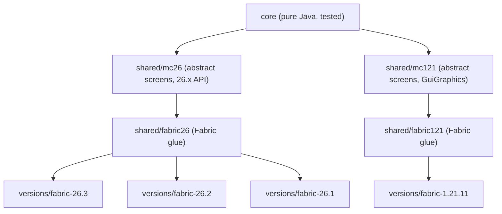

# Chat Notes — Architecture

High-level flow: **keybind → Notes screen → Copy (clipboard) or Use (pre-fill chat)**. Notes never auto-send.

The same behaviour is built four times, once per Minecraft version. Shared code is compiled into each jar. Nothing publishes the core jar.

**Quick links:** [Flow](#flow-detailed) · [Module graph](#module-graph) · [Version seam](#version-seam) · [File layout](#file-layout)

---

## Flow (detailed)

### 1. Startup

1. Fabric loads the client-only mod and calls `ChatNotesClient.onInitializeClient()`.
2. `FabricChatNotes` opens `config/chatnotes/notes.json` through `NoteStore` (atomic load with corrupt-file recovery).
3. If the store is empty, a demo note is seeded so the vertical-slice path is immediately testable.
4. `KeyBindings.register()` installs the open-notes key (default **K**) and an `END_CLIENT_TICK` listener.

### 2. Opening the notes screen

1. In-world, the user presses **K** (or their rebound key).
2. The tick listener sees `openNotes.consumeClick()` and, if a player exists, asks the version module to show `NotesScreen`.
3. `NotesScreen` shows search, a group filter, a scrollable note list, and action buttons.

### 3. Using a note

| Action | Result |
|--------|--------|
| **Copy** | Exact stored text goes to the system clipboard via `ClipboardAccess` |
| **Use** | Opens `ChatScreen(text, false)` with the text pre-filled; nothing is sent |
| **Add / Edit** | Opens `NoteEditScreen`; Save writes through `NoteStore` (line breaks → space) |
| **Delete** | Vanilla `ConfirmScreen`, then remove + save |
| **Move up/down** | Reorders the full list (disabled while a search filter is active) |
| **Groups** | Create, rename, and delete groups; assign a note to one |
| Double-click row | Same as **Use** |

### 4. Text handling

- Stored bytes are never rewritten except collapsing line breaks to a single space (chat is single-line).
- Ampersand codes (`&a`, `&#RRGGBB`, `&x&R&R&G&G&B&B`) are parsed by `AmpersandParser` into `TextSpan` records and drawn through `Painter`. Display only.
- A visible warning appears when text contains `§`. Vanilla chat rejects it and many servers disconnect the player. Prefer `&` codes that the server translates.

---

## Module graph



Each version module adds `core/` and the matching `shared/` trees as extra `sourceSets.main.java.srcDirs` and compiles them again against its own Minecraft. A future API break fails in that module's compile, not in a shared binary.

`versions/fabric-1.21.11` is an included build. It needs `fabric-loom-remap` 1.14, which cannot share a buildscript classpath with the `fabric-loom` 1.19 used by the 26.x modules. Those three are ordinary subprojects of the root build.

`:core` is a real Gradle project so its tests run without Loom. No version module depends on the core jar.

---

## Version seam

Two layers absorb the Minecraft changes.

`core/render/Painter` hides drawing. `shared/mc121` implements it with `GuiGraphics`. `shared/mc26` implements it with `GuiGraphicsExtractor` (`text`, `centeredText`, `fill`, `outline`). The abstract screens call `extractRenderState`, `extractBackground`, and `extractContent` on 26.x, and `render`, `renderBackground`, and `renderContent` on 1.21.

The screens then leave two calls to the version module:

- `openScreen(Screen)` — `minecraft.setScreen` on 1.21.11 and 26.1; `minecraft.gui.setScreen` on 26.2 and 26.3.
- `chatScreenWith(String)` — `new ChatScreen(text, false)` on every current version.

The keybind cannot call `setScreen` itself, because that method moved. `FabricChatNotes.ScreenDisplay` is the hook the version module passes at startup. On 26.x the key registration is `new KeyMapping(name, InputConstants.KEY_K, Category.MISC)`, which selects `KEYSYM` when compiled for 26.1 or 26.2 and `KEYBOARD` for 26.3. 1.21.11 keeps its own `shared/fabric121` and still names `InputConstants.Type.KEYSYM`.

`shared/mc26` and `shared/mc121` import no Fabric types. `CoreBoundaryTest` fails the build if they do. That is what keeps a future loader from having to fork the screens.

---

## Component overview

| Component | Role |
|-----------|------|
| **ChatNotesClient** | Version entry point. Chooses the notes screen and how this Minecraft build shows it |
| **FabricChatNotes** | Opens the store, seeds the demo note, and registers the keybind |
| **KeyBindings** | Registers the open-notes key and listens for it in-world |
| **AbstractNotesScreen** and the other abstract screens | Search, list, editor, groups. Draw through `Painter` |
| **NotesScreen** and the other concrete screens | Implement `openScreen` and, for notes, `chatScreenWith` |
| **NoteStore / NoteStoreFile** | In-memory CRUD plus Gson persistence |
| **AmpersandParser** | Parse `&` codes into `TextSpan` records. No Minecraft types |
| **MinecraftClipboard** | `ClipboardAccess` over `keyboardHandler` |

---

## File layout

```
core/src/main/java/.../core/
├── data/       # Note, Group, NoteStore, NoteStoreFile
├── text/       # AmpersandParser, TextSpan
├── model/      # GroupFilter, NoteRules, GroupAccent
├── render/     # Painter, NotesPainting, GroupsPainting
└── platform/   # ClipboardAccess, ConfigPaths, ModLog
shared/mc121/   # abstract screens + GuiGraphicsPainter
shared/mc26/    # abstract screens + ExtractorPainter
shared/fabric121/
shared/fabric26/
versions/fabric-1.21.11/   # included build; assets, fabric.mod.json, thin screens
versions/fabric-26.1/      # subproject; openScreen is minecraft.setScreen
versions/fabric-26.2/      # subproject; openScreen is minecraft.gui.setScreen
versions/fabric-26.3/      # subproject; same screen calls as 26.2
```

Language files and the icon live inside each version module. Persistence stays `config/chatnotes/notes.json` under the game directory (`versions/<module>/run/config/…` for `runClient`).

---

## Dependencies (conceptual)

- **Fabric API, 1.21.11:** `ClientModInitializer`, `KeyBindingHelper`, `ClientTickEvents`
- **Fabric API, 26.x:** `ClientModInitializer`, `KeyMappingHelper`, `ClientTickEvents`
- **Minecraft client:** `Screen`, `ObjectSelectionList`, `EditBox`, `MultiLineEditBox`, `ChatScreen`, `ConfirmScreen`, clipboard via `KeyboardHandler`
- **Gson:** shipped with Minecraft. `:core` depends on Gson 2.11.0 only so its tests can run

No mixins. Version-sensitive calls stay in the concrete screens and in `ChatNotesClient`.
