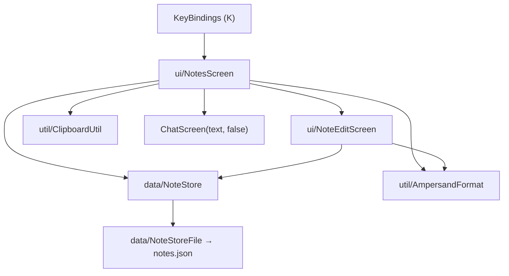
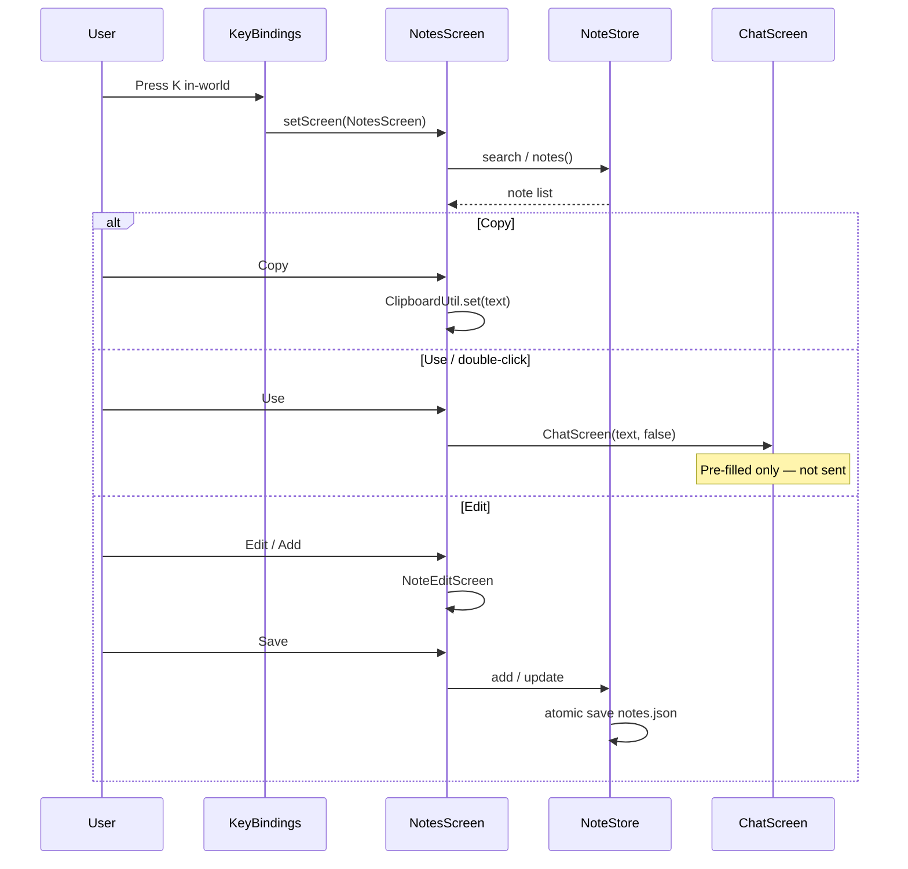

# Chat Notes — Architecture

High-level flow: **keybind → Notes screen → Copy (clipboard) or Use (pre-fill chat)**. Notes never auto-send.

**Quick links:** [Flow](#flow-detailed) · [Component overview](#component-overview) · [Sequence](#sequence) · [File layout](#file-layout)

---

## Flow (detailed)

### 1. Startup

1. Fabric loads the client-only mod and calls `ChatNotesClient.onInitializeClient()`.
2. The client opens `config/chatnotes/notes.json` through `NoteStore` (atomic load with corrupt-file recovery).
3. If the store is empty, a demo note is seeded so the vertical-slice path is immediately testable.
4. `KeyBindings.register()` installs the open-notes key (default **K**) and an `END_CLIENT_TICK` listener.

### 2. Opening the notes screen

1. In-world, the user presses **K** (or their rebound key).
2. The tick listener sees `openNotes.consumeClick()` and, if a player exists, opens `NotesScreen`.
3. `NotesScreen` shows search, a scrollable note list, and action buttons.

### 3. Using a note

| Action | Result |
|--------|--------|
| **Copy** | Exact stored text goes to the system clipboard via `ClipboardUtil` |
| **Use** | Opens `ChatScreen(text, false)` with the text pre-filled; nothing is sent |
| **Add / Edit** | Opens `NoteEditScreen`; Save writes through `NoteStore` (line breaks → space) |
| **Delete** | Vanilla `ConfirmScreen`, then remove + save |
| **Move up/down** | Reorders the full list (disabled while a search filter is active) |
| Double-click row | Same as **Use** |

### 4. Text handling

- Stored bytes are never rewritten except collapsing line breaks to a single space (chat is single-line).
- Ampersand codes (`&a`, `&#RRGGBB`, `&x&R&R&G&G&B&B`) are previewed in colour by `AmpersandFormat` — display only.
- A visible warning appears when text contains `§`. Vanilla chat rejects it and many servers disconnect the player. Prefer `&` codes that the server translates.

---

## Architecture diagram



`data/` has **no Minecraft imports**, so it unit-tests without launching the game.

---

## Component overview

| Component | Role |
|-----------|------|
| **ChatNotesClient** | Client entry point: open store, seed demo if empty, register keybind |
| **KeyBindings** | Isolates `KeyMapping` registration (port surface for older MC versions) |
| **NotesScreen** | Search, list, selection actions, § warning, coloured previews |
| **NoteEditScreen** | Title + text editor, Paste, char counter, coloured preview, § warning |
| **NoteStore / NoteStoreFile** | In-memory CRUD + Gson persistence (atomic write, `.bak`, corrupt rename) |
| **ClipboardUtil** | Thin wrapper over `keyboardHandler` clipboard |
| **AmpersandFormat** | Parse `&` / `&#RRGGBB` / `&x…` into styled `Component` for preview |

---

## Sequence



---

## File layout

```
src/main/java/com/imjpfeliciano/chatnotes/
├── ChatNotesClient.java
├── data/          # Note, Group, NoteStore, NoteStoreFile, NotesDocument
├── input/         # KeyBindings
├── ui/            # NotesScreen, NoteEditScreen
└── util/          # ClipboardUtil, AmpersandFormat
```

Persistence path: `config/chatnotes/notes.json` under the game directory (`run/config/…` for `./gradlew runClient`).

---

## Dependencies (conceptual)

- **Fabric API:** `ClientModInitializer`, `KeyBindingHelper`, `ClientTickEvents`
- **Minecraft client:** `Screen`, `ObjectSelectionList`, `EditBox`, `ChatScreen`, `ConfirmScreen`, clipboard via `KeyboardHandler`
- **Gson:** shipped with Minecraft; used only inside `NoteStoreFile`

No mixins in v1. Version-sensitive surfaces stay in `KeyBindings`, `ClipboardUtil`, and `ui/`.
