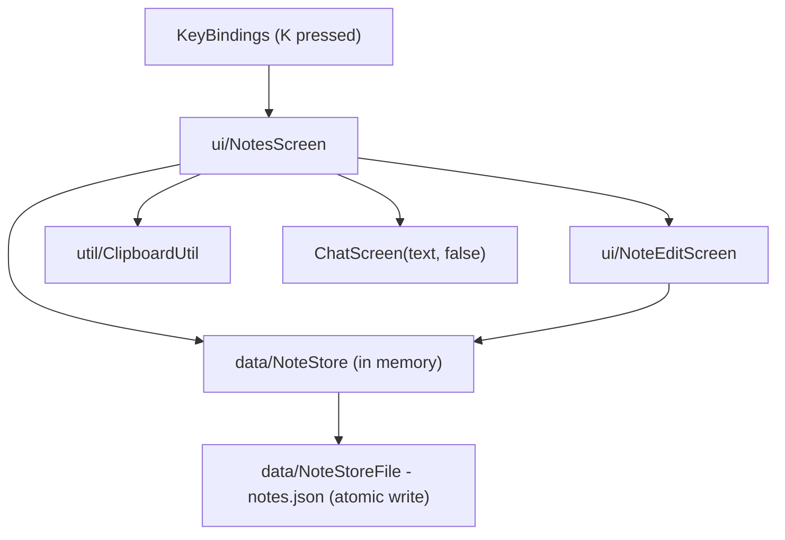

# Chat Notes (Fabric 1.21.11): Implementation Plan

*Supersedes the version targeting in [Chat Notes (Fabric 1.21.8) Discovery & Implementation Plan.md](<Chat Notes (Fabric 1.21.8) Discovery & Implementation Plan.md>). That document remains the reference for goals, data model, UX spec and the acceptance checklist.*

Client-only Fabric mod: a personal library of chat snippets you can **Copy** to the clipboard or **Use** (pre-fill the chat box). Built in `minecraft-notes-to-clipboard`, bootstrapped from the working [chat-designer-mc](../../chat-designer-mc) scaffold.

**Target decided with the owner:** Minecraft **1.21.11** only (the version actually played). The discovery document's 1.21.8 target becomes an optional backport at the very end, not a constraint on the code.

## What we reuse from `chat-designer-mc`

Copy verbatim (this is the part that normally takes a beginner a full day to get right):

- [gradlew](../../chat-designer-mc/gradlew), [gradlew.bat](../../chat-designer-mc/gradlew.bat), [gradle/wrapper/](../../chat-designer-mc/gradle/wrapper) - Gradle 9.2.1 wrapper
- [settings.gradle](../../chat-designer-mc/settings.gradle) - Fabric plugin repositories
- [.gitignore](../../chat-designer-mc/.gitignore), [.gitattributes](../../chat-designer-mc/.gitattributes) - already correct for Fabric (`run/`, `.gradle/`, `build/`)
- [.github/workflows/build.yml](../../chat-designer-mc/.github/workflows/build.yml) - CI on JDK 21, uploads the jar
- [.vscode/](../../chat-designer-mc/.vscode) - debug attach config (retarget to `runClient`)

Copy and adapt:

- [build.gradle](../../chat-designer-mc/build.gradle) - Mojang mappings are already wired (`mappings loom.officialMojangMappings()`), Java 21 release target, `withSourcesJar()`. Changes: rename the `loom.mods { "modid" }` block to `"chatnotes"`, add JUnit 5 for the storage tests.
- [gradle.properties](../../chat-designer-mc/gradle.properties) - keep `minecraft_version=1.21.11`, `loader_version=0.18.2`, `loom_version=1.14-SNAPSHOT`, `fabric_version=0.139.4+1.21.11`. Change `maven_group` to `com.imjpfeliciano`, `archives_base_name` to `chatnotes`. Delete the stale unused `yarn_mappings` line.
- [KeybindHandler.java](../../chat-designer-mc/src/main/java/com/imjpfeliciano/chatdesignermc/KeybindHandler.java) - becomes `input/KeyBindings.java` almost line for line. The `KeyBindingHelper.registerKeyBinding` + `ClientTickEvents.END_CLIENT_TICK` + `while (key.consumeClick())` pattern is exactly what Chat Notes needs; only the key (G to K) and the name change.
- [ModInitializer.java](../../chat-designer-mc/src/main/java/com/imjpfeliciano/chatdesignermc/ModInitializer.java) - becomes `ChatNotesClient.java`; same `MOD_ID` + SLF4J `LOGGER` shape.
- [DesignerScreen.java](../../chat-designer-mc/src/main/java/com/imjpfeliciano/chatdesignermc/DesignerScreen.java) - not copied wholesale, but it is our reference for `Screen.init()` widget layout, `Button.builder(...).pos().size().build()`, `MultiLineEditBox.builder()`, `renderTransparentBackground`, and the custom `AbstractWidget` subclass trick for draw-order control.
- [docs/ARCHITECTURE.md](../../chat-designer-mc/docs/ARCHITECTURE.md) - reuse its structure (flow, component table, mermaid sequence) for the new mod's docs.

Deliberately dropped: `ServerInitializer.java`, `ServerChatFormatHandler.java`, `docs/SERVER_PROTOCOL.md`, `src/client/` example leftovers, and all mixins. Chat Notes is client-only and needs **zero** mixins in v1.

## Mistakes in the old project we fix while copying

These are the "pro reviewer" notes - each is a real defect in `chat-designer-mc` worth not repeating:

- `fabric.mod.json` still ships template metadata: `"description": "This is an example description!"`, `"authors": ["Me!"]`, homepage pointing at fabricmc.net, `"license": "CC0-1.0"`, icon at `assets/modid/icon.png`.
- It declares `"environment": "*"` while only having client logic. Chat Notes sets `"environment": "client"` so the loader never tries to run it server-side.
- Every UI string is a hardcoded `Component.literal("Bold")`. We use `Component.translatable(...)` with an `en_us.json` from day one; retrofitting translations later is tedious.
- `DesignerScreen.selectColor` re-derives selection state by string-matching button labels (`msg.equals("[White]")`). Keep widget state in fields, never in rendered text.
- `gradle.properties` hardcodes `org.gradle.java.home=/opt/homebrew/opt/openjdk@21/...`. The system `java` is 24, so this is doing real work - but a Gradle **toolchain** (`java { toolchain { languageVersion = JavaLanguageVersion.of(21) } }`) is the portable way and keeps CI happy. Keep the absolute path as a local fallback only if the toolchain can't find the JDK.

## Verified 1.21.11 APIs (checked against the decompiled jar, not guessed)

- Clipboard: `Minecraft.getInstance().keyboardHandler.getClipboard()` / `.setClipboard(String)`.
- "Use" action: the constructor is **`ChatScreen(String initial, boolean isDraft)`** in 1.21.11 (it was single-arg in 1.21.8). Call `minecraft.setScreen(new ChatScreen(note.text(), false))`.
- Keybind: `new KeyMapping(String, InputConstants.Type.KEYSYM, int, KeyMapping.Category.MISC)` - the `Category` object form, which is what `KeybindHandler.java` already uses. A custom category is available via `KeyMapping.Category.register(Identifier)` if we want our own section in Controls.
- List widget: both `ObjectSelectionList` and `ContainerObjectSelectionList` exist; base class `AbstractSelectionList` provides `addEntry`, `getSelected`, `setSelected`, `replaceEntries`, `children()`. Use `ObjectSelectionList` for the notes list (rows are selectable, not nests of widgets).
- Text field: `EditBox.setMaxLength(int)` and `setResponder(Consumer<String>)` for live search. Default max length is 32, so always set it.
- Note: in 1.21.11 Mojang mappings the resource class is `net.minecraft.resources.Identifier`, not `ResourceLocation`.

## Architecture

`data/` has **no Minecraft imports**, so it compiles and tests in milliseconds without launching the game.

## Phases

Each phase ends with something you can see or run. Stop and review at each boundary.

### Phase 0 - Bootstrap (goal: dev client launches with your mod listed)

1. Copy the reusable files listed above from `chat-designer-mc` into `minecraft-notes-to-clipboard` (it is an initialized git repo with no commits yet, containing only `plans/`).
2. Rename to mod id `chatnotes`, package `com.imjpfeliciano.chatnotes`, archives base name `chatnotes`.
3. Write a clean `fabric.mod.json`: `"environment": "client"`, only a `client` entrypoint, real description/author, MIT license, `depends` on `minecraft ~1.21.11`, `java >=21`, `fabric-api *`.
4. Delete server classes, `src/client/` leftovers, and mixin JSONs.
5. Add `LICENSE` (MIT) and a README recording the exact Loom/loader/Fabric API versions.
6. Verify `./gradlew build` and `./gradlew runClient`, then make the first git commit.

**Done when:** the dev client starts, Mods list shows Chat Notes, and the log has your init line.

### Phase 1 - Storage layer, pure Java (goal: green tests, no game needed)

- `data/Note` (record: `id`, `title`, `text`, `groupId`, `order`, `createdAt`, `updatedAt`), `data/Group`, `data/NoteStore` (in-memory CRUD + reorder + search), `data/NoteStoreFile` (Gson, `schemaVersion: 1`).
- Storage path: `FabricLoader.getInstance().getConfigDir().resolve("chatnotes/notes.json")` - resolved by the caller and passed in as a `Path`, so `data/` stays Minecraft-free.
- Safety rules from the discovery document: write temp file then atomic move, keep one `.bak`, and on corrupt JSON rename to `notes.corrupt-<timestamp>.json` and start empty rather than lose data.
- JUnit 5 tests: round trip, unknown fields ignored, corrupt file recovery, ordering, CRUD.

**Done when:** `./gradlew test` passes and no file under `data/` imports `net.minecraft`.

### Phase 2 - Vertical slice (goal: prove the whole loop end to end)

The highest-value step for a first mod: wire the thinnest possible path before building real UI.

- `input/KeyBindings` (ported from `KeybindHandler`, default **K**) opens a bare `NotesScreen`.
- `util/ClipboardUtil` wrapping `keyboardHandler`.
- The screen shows the first note from disk plus two buttons: **Copy** and **Use**.
- Confirm the exact bytes survive: paste into an external app, and confirm `&l`-style codes reach the chat box unchanged.

**Done when:** pressing K in-world, clicking Use, and seeing `&lVENDO &e&lKIT ZEUS &a&l550K` pre-filled in chat without being sent.

### Phase 3 - Full MVP UI

- `ObjectSelectionList` of notes: title (or truncated text preview), dimmed one-line preview, red char count when over 256.
- Search `EditBox` with `setResponder` filtering live; **Add note** button.
- `ui/NoteEditScreen`: title field, large text field (`setMaxLength(4096)`), **Paste from clipboard**, live `n / 256` counter, Save disabled when empty, line breaks collapsed to a space.
- Selection-driven buttons: Use, Copy, Edit, Delete (vanilla `ConfirmScreen`), Move up/down. Double-click a row = Use.
- `en_us.json` translation keys for every string.

**Done when:** the acceptance checklist from section 9 of the discovery document passes in a real client against your server, including a restart and a 500-note scroll test.

### Phase 4 - Polish

- Colored preview rendering `&`-codes and `&#RRGGBB` in the list (pulled forward since the owner's format is ampersand codes).
- Visible warning if stored text contains `§` - `chat-designer-mc` proved firsthand that sending it disconnects the player.
- `docs/ARCHITECTURE.md` in the style of the old project's doc.

### Phase 5 - Groups

Single-level folders using the `groupId` already in the schema: create/rename/delete (with a move-to-Ungrouped choice), and a group filter in the list.

### Phase 6 - Chat integration and release

- Notes panel or button inside `ChatScreen` via Fabric `ScreenEvents.AFTER_INIT`; may need an access widener for the chat input field - keep it in one isolated class.
- Import/export JSON, optional Mod Menu entry, mod icon, changelog.
- Optional 1.21.8 backport: only `KeyBindings` (String category) and the `ChatScreen` constructor arity need to change, both already isolated.

## Open items carried from the discovery document

Defaults to proceed with unless the owner says otherwise: mod name **Chat Notes** / id `chatnotes`, keybind **K**, MIT license, notes stored globally (not per server), line breaks collapsed to a space, `§` stored verbatim but flagged with a warning, and never auto-sending a message.
