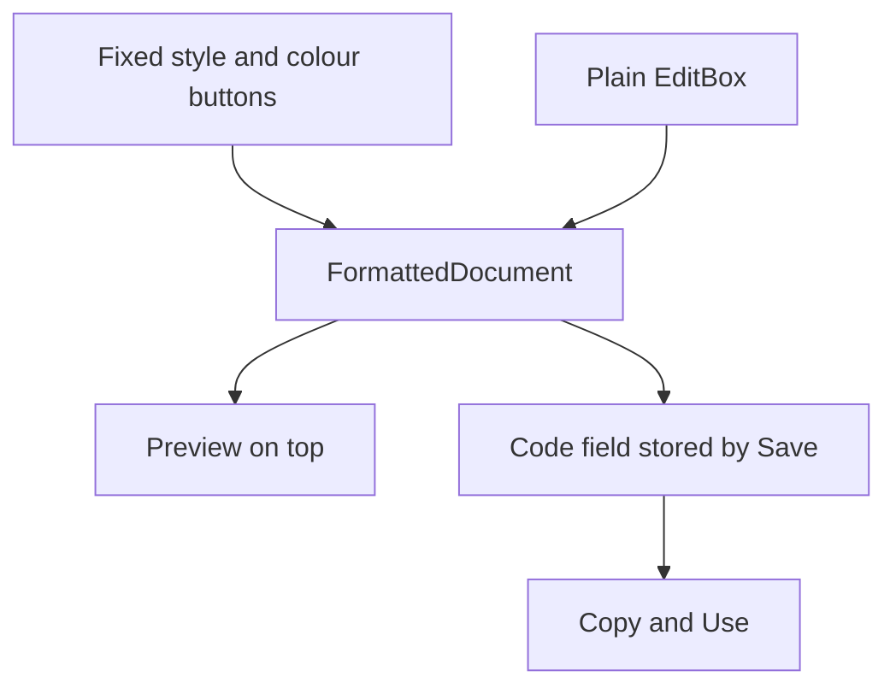

# Chat Notes: formatting toolbar

A fixed palette, same codes every time. No hex field, no gradient, no rainbow, no custom RGB.

**1.21.11 is the first version.** That is the version played most, and its editor is [`shared/mc121/.../AbstractNoteEditScreen.java`](shared/mc121/src/main/java/com/imjpfeliciano/chatnotes/ui/AbstractNoteEditScreen.java). Build the toolbar there, play it with `:fabric-1.21.11:runClient`, and only then copy the same layout into [`shared/mc26/.../AbstractNoteEditScreen.java`](shared/mc26/src/main/java/com/imjpfeliciano/chatnotes/ui/AbstractNoteEditScreen.java) for 26.1, 26.2, and 26.3.

Styling math stays in `core` (no Minecraft types), so the 26.x copy does not redo it. Copy and Use already send `note.text()`, so chat receives whatever Save stored.

## Buttons and the codes they write

Style, matching the sample’s top row:

- Bold `&l`, Italic `&o`, Underline `&n`, Strikethrough `&m`, Obfuscated `&k`, Reset `&r`

Colours, the two rows of swatches in the sample. These are the vanilla chat colours, and each swatch always writes that one code:

- `&0` black, `&1` dark blue, `&2` dark green, `&3` dark aqua, `&4` dark red, `&5` dark purple, `&6` gold, `&7` gray
- `&8` dark gray, `&9` blue, `&a` green, `&b` aqua, `&c` red, `&d` light purple, `&e` yellow, `&f` white

A colour code resets decorations, which [`AmpersandParser`](core/src/main/java/com/imjpfeliciano/chatnotes/core/text/AmpersandParser.java) already does. After a colour, the serializer writes the decorations again, so yellow + bold is always `&e&l`.

Example for the sample line: `NUEVA &e&lGRANJA DE ORO&r - &cS1&r - 72` and `&bSPAWNERS DE PIGLIN`.

The formatter never writes `§`, `&#RRGGBB`, or `&x&...`. Existing notes that already contain those still preview, and Save leaves them unchanged until a format button rewrites the selection.

## Layout

Under the group picker, first on the 1.21.11 editor:

- One row of style buttons, then two rows of 8 swatches (drawn with `Painter.fill`, clicked in `mouseClicked`)
- Coloured preview on top, using the preview that already exists
- Plain `EditBox`: type here and select the words to style
- Code `EditBox` underneath: the `&` string. This is what Save writes
- Character counter of that code string, the existing `§` warning, Paste, Save, Cancel

Clicking a button drops focus, so the screen reads the plain field’s selection first. `EditBox.getCursorPosition()` and `getHighlightPos()` are public on every current version. `MultiLineEditBox` is not used for this, because chat is already one line.

A selection restyles that range and refreshes the code field. No selection sets the style at the caret, and the next characters you type pick it up. Bold on a fully bold selection turns bold off.

## Phases

### Phase 1 — Document model and unit tests

`FormattedDocument` beside the parser:

- Parse with `AmpersandParser`, then treat button-applied colours as the 16 codes above
- `apply(start, end, change)` merges runs
- `insert` / `delete` keep styles attached to the plain characters
- `serialize()` writes only `&0`–`&f` and `&k` `&l` `&m` `&n` `&o` `&r`

New [`core/src/test/java/com/imjpfeliciano/chatnotes/core/text/FormattedDocumentTest.java`](core/src/test/java/com/imjpfeliciano/chatnotes/core/text/FormattedDocumentTest.java), same JUnit 5 style as [`AmpersandParserTest`](core/src/test/java/com/imjpfeliciano/chatnotes/core/text/AmpersandParserTest.java). `./gradlew :core:test` is the gate, and the existing `core` job in [`.github/workflows/build.yml`](.github/workflows/build.yml) already runs it on every push and pull request. No workflow change.

Cases in that class:

- Each of the 16 swatches serializes to its one code, including a single selected character
- Each decoration: `&l` `&o` `&n` `&m` `&k`
- Yellow then bold is `&e&l`, and the colour code is written before the decoration
- Reset on a styled selection returns plain text
- Bold on a fully bold selection removes `&l`; bold on a mixed selection turns the whole range bold
- A middle-of-string selection leaves the text outside the range unchanged
- Two neighbouring runs with the same style merge into one code
- Typing into a coloured word inherits that colour; backspace shrinks the run
- An empty selection does not rewrite the string; the next insert uses the caret style
- Reversed or out-of-range indexes do not throw and do not corrupt the string
- Pasting plain text and pasting an `&` string both land in the document
- `serialize()` then parse then `serialize()` is stable
- The sample line serializes as `NUEVA &e&lGRANJA DE ORO&r - &cS1&r - 72` plus `&bSPAWNERS DE PIGLIN`
- Output contains no `§`, no `&#`, and no `&x`
- An existing hex or `&x` note is left byte-for-byte alone until `apply` touches a range

[`AmpersandParserTest`](core/src/test/java/com/imjpfeliciano/chatnotes/core/text/AmpersandParserTest.java) and [`CoreBoundaryTest`](core/src/test/java/com/imjpfeliciano/chatnotes/core/CoreBoundaryTest.java) stay as they are. The new class must keep `core/` free of `net.minecraft` and `net.fabricmc` imports, which that boundary test already fails the build for.

### Phase 2 — 1.21.11 editor, then a manual pass

Change only [`shared/mc121/.../AbstractNoteEditScreen.java`](shared/mc121/src/main/java/com/imjpfeliciano/chatnotes/ui/AbstractNoteEditScreen.java) and the lang files under `versions/fabric-1.21.11`. Leave `shared/mc26` alone in this phase.

Preview stays `NotesPainting.preview`. The two fields stay in sync without a feedback loop. Paste parses `&` codes into the document. Save writes `Note.normalizeText` of the code field. List, Copy, and Use stay as they are.

Add the button labels to `en_us`, `es_mx`, and `es_es` in `versions/fabric-1.21.11`.

There is no automated UI test in this repo. Play this phase with `:fabric-1.21.11:runClient`.

Manual matrix, on 1.21.11:

- New note: type `NUEVA GRANJA DE ORO - S1 - 72`, select `GRANJA DE ORO`, press yellow then bold, select `S1`, press red. Preview matches the sample colours. The code field shows `&e&l` and `&c`. Save, then the list row previews those colours.
- Copy puts the code field’s exact string on the clipboard. Use opens chat with that string and does not send.
- Edit an existing `&` note, change only the title, Save: the message bytes are unchanged.
- Edit an existing note that contains `&#` or `&x`, do not press a format button, Save: those codes are still in the file.
- Press a format button on that note: the touched range becomes a legacy `&` code; the counter counts the code string and turns red past 256.
- A note containing `§` still shows the section-sign warning.
- Paste of `&a&lHi` fills the plain field with `Hi` and the code field with `&a&lHi`.
- No selection, press yellow, type: the new characters are `&e`.
- Bold on a fully bold word removes bold. Reset clears the selection.
- Cancel drops the edit. Line breaks in either field become a single space on save.
- `en_us`, `es_mx`, and `es_es` show the new button labels, with no raw translation keys.
- Resize the editor once and confirm the toolbar, preview, and both fields stay inside the screen.

### Phase 3 — Copy the same editor to 26.1–26.3

Start this only after the 1.21.11 matrix passes. Copy the Phase 2 layout into [`shared/mc26/.../AbstractNoteEditScreen.java`](shared/mc26/src/main/java/com/imjpfeliciano/chatnotes/ui/AbstractNoteEditScreen.java), and copy the new lang keys into `versions/fabric-26.1`, `versions/fabric-26.2`, and `versions/fabric-26.3`.

`shared/mc26` is one screen tree for all three 26.x modules. Verify it once with `:versions:fabric-26.3:runClient` and the same manual matrix. 26.1 and 26.2 need a pass only if 26.3 fails to compile.

## Done when

- `./gradlew :core:test` passes, including `FormattedDocumentTest` and the existing parser tests.
- The manual matrix passes on 1.21.11. That is the gate for calling the feature done.
- Phase 3 is a follow-up: the same matrix passes on 26.3.

## Limits

- Preview is client-side. The server plugin is what colours `&` codes in chat, same as today.
- The plain field is uncoloured so selection works on every version. The colours show in the preview above it.
- Stored chat text stays one line. A note can still show a wrapped preview.
