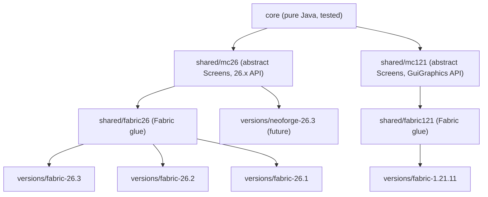

# Chat Notes: multi-version port architecture (26.3 Fabric first)

*Supersedes the single-version targeting in [Chat Notes (Fabric 1.21.11) Implementation Plan.md](<Chat Notes (Fabric 1.21.11) Implementation Plan.md>). That document remains the reference for goals, data model, UX spec and the acceptance checklist.*

**Goal:** restructure Chat Notes into a monorepo with a version-independent core plus one thin module per Minecraft version and loader, port to **26.3 Fabric** first, then clone that port to 26.2 and 26.1 by overriding two small hooks. NeoForge and Forge stay out of scope but the structure must make them cheap.

## What the research found

Facts verified against `piston-meta.mojang.com`, `meta.fabricmc.net`, the Modrinth Fabric API index, `FabricMC/fabric-example-mod`, and direct class-file inspection of the 26.1 / 26.2 / 26.3 client jars.

**26.x is a platform change, not a version bump:**

- Minecraft 26.1, 26.2, 26.3 (and 26.1.1 / 26.1.2) are **unobfuscated**. The version manifest has no `client_mappings` entry and Fabric publishes intermediary `0.0.0` as a placeholder. `mappings loom.officialMojangMappings()` must be **removed**.
- The Loom plugin changes from `net.fabricmc.fabric-loom-remap` to **`net.fabricmc.fabric-loom`** (`1.19.4`, a stable release — see Phase 0), and dependencies are declared with `implementation`, not `modImplementation`.
- **Java 25** is required (`javaVersion.majorVersion = 25`, `java-runtime-epsilon`), with `options.release = 25` and Gradle **9.8.2**. Loom 1.19 also requires the Gradle **daemon** to run on Java 25, not just the compile toolchain.
- `net.minecraft.client.gui.GuiGraphics` **no longer exists**. Screens override `extractRenderState(GuiGraphicsExtractor, int, int, float)`; list rows override `extractContent(GuiGraphicsExtractor, int, int, boolean, float)`. Drawing calls are renamed: `drawString` to `text`, `drawCenteredString` to `centeredText`, `renderOutline` to `outline`, `renderBackground` to `extractBackground`. `fill` keeps its shape. Every one of the five screens is affected.
- Fabric API renamed the keybind helper: `net.fabricmc.fabric.api.client.keybinding.v1.KeyBindingHelper.registerKeyBinding` becomes `net.fabricmc.fabric.api.client.keymapping.v1.KeyMappingHelper.registerKeyMapping`. `ClientTickEvents` and `FabricLoader.getConfigDir()` are unchanged.

**26.1 to 26.3 are nearly identical for this mod.** A full signature diff of every class Chat Notes touches found only two relevant differences, which is what makes the inheritance model cheap:

- `Minecraft.setScreen(Screen)` exists in 26.1 but moved to `Minecraft.gui.setScreen(Screen)` in 26.2+ (the `Minecraft.screen` field is gone).
- `ChatFormatting.isColor()`, `getColor()`, `getChar()`, `getId()`, `getByName()`, `getById()` and the codecs were deleted in 26.2+. Only `getByCode(char)`, `values()`, `stripFormatting()` and `PREFIX_CODE` survive. `AmpersandFormat` uses `isColor()` today.

Unchanged across 26.1 to 26.3 and therefore safe in shared code: `ObjectSelectionList(Minecraft, int, int, int, int)`, `mouseClicked(MouseButtonEvent, boolean)`, `ChatScreen(String, boolean)`, `ConfirmScreen(BooleanConsumer, Component, Component)`, `EditBox`, `MultiLineEditBox.builder()`, `CycleButton.builder(...).withValues(...).create(...)`, `Button.builder(...).bounds(...).build()`, `CommonColors`, `Font.substrByWidth` / `plainSubstrByWidth`, `Language.getVisualOrder`, `Style.applyLegacyFormat` / `applyFormat`, `TextColor.fromRgb`, `KeyMapping(String, InputConstants.Type, int, KeyMapping.Category)`, `KeyboardHandler.getClipboard` / `setClipboard`.

**Verified per-version toolchain values:**

- 26.3: loader `0.20.1`, Fabric API `0.166.2+26.3`, Loom `1.19.4`, Java 25
- 26.2: loader `0.20.1`, Fabric API `0.161.0+26.2`, Loom `1.19.4`, Java 25
- 26.1: loader `0.20.1`, Fabric API `0.155.3+26.1.2` (covers 26.1, 26.1.1, 26.1.2), Loom `1.19.4`, Java 25
- 1.21.11 (existing): loader `0.18.2`, Fabric API `0.139.4+1.21.11` (latest is `0.141.6+1.21.11`), Loom `1.14-SNAPSHOT` with `fabric-loom-remap`, Java 21

## Target structure

A monorepo. One pure-Java core, shared source directories per API era and per loader, and one thin module per version-and-loader combination.

```
chat-notes/
├── settings.gradle            # include ':core' + ':versions:fabric-26.1|26.2|26.3'
│                              # includeBuild 'versions/fabric-1.21.11'  (isolated: needs the other Loom plugin)
├── gradle.properties          # mod_version, maven_group, archives_base_name
├── core/                      # plain java-library, release 21, JUnit 5. No Minecraft, no loader imports.
│   └── src/main/java/com/imjpfeliciano/chatnotes/core/
│       ├── data/              # Note, Group, NoteStore, NoteStoreFile, NotesDocument (moved as-is)
│       ├── text/              # AmpersandParser -> List<TextSpan>; no ChatFormatting dependency
│       ├── model/             # NotesViewModel, GroupsViewModel, GroupFilter sentinels + rules
│       ├── render/            # Painter, TextMeasurer, Translator SPIs + NotesPainting/GroupsPainting
│       └── platform/          # ClipboardAccess, ConfigPaths, ModLog SPIs
├── shared/
│   ├── mc26/src/main/java/      # abstract Screens for 26.1-26.3 (vanilla API only, zero loader imports)
│   ├── mc121/src/main/java/     # abstract Screens for 1.21.x (GuiGraphics era)
│   ├── fabric26/src/main/java/  # Fabric glue for 26.x: KeyMappingHelper, ClientTickEvents, FabricLoader
│   ├── fabric121/src/main/java/ # Fabric glue for 1.21.x: KeyBindingHelper
│   └── resources/               # assets/chatnotes/lang/*.json + icon.png
└── versions/
    ├── fabric-26.3/           # build.gradle, gradle.properties, fabric.mod.json, ~5 concrete classes
    ├── fabric-26.2/
    ├── fabric-26.1/
    └── fabric-1.21.11/        # own settings.gradle (separate build), same core
```



Sharing happens at **source level**, not through a published jar: each version module adds the directories it needs as extra `srcDirs`, so everything is recompiled against its own Minecraft and a future breaking change fails loudly at compile time in exactly one place.

```gradle
// versions/fabric-26.3/build.gradle
def shared = "$rootDir"   // for versions/fabric-1.21.11 this is "$rootDir/../.."
sourceSets.main {
    java.srcDirs += ["$shared/core/src/main/java",
                     "$shared/shared/mc26/src/main/java",
                     "$shared/shared/fabric26/src/main/java"]
    resources.srcDirs += ["$shared/shared/resources"]
}
```

`:core` stays a real Gradle module so its tests run once, fast, without Loom or Minecraft. Its classes are compiled a second time into each mod jar via `srcDirs`, which avoids shading and jar-in-jar entirely. Nothing depends on or publishes the core jar. The alternative, `project(':core')` plus the Shadow plugin, was rejected: it adds a shading step and a Loom `remapJar` interaction for no benefit at this size.

`versions/fabric-1.21.11` must be an `includeBuild`, not a subproject: `fabric-loom-remap` 1.14 and `fabric-loom` 1.19 cannot share one buildscript classpath. The three 26.x modules share Loom 1.19 and live in the root build as ordinary subprojects.

## The version seam

Everything version-sensitive is reduced to a handful of abstract hooks. `core/render/Painter` is the one that absorbs the `GuiGraphics` removal:

```java
public interface Painter {
    void text(String text, int x, int y, int argb);
    void centeredText(String text, int centerX, int y, int argb);
    void spans(List<TextSpan> spans, int x, int y, int maxWidth, int fallbackArgb);
    void fill(int x1, int y1, int x2, int y2, int argb);
    void outline(int x, int y, int width, int height, int argb);
}
```

`shared/mc26` implements it over `GuiGraphicsExtractor`, `shared/mc121` over `GuiGraphics`. The abstract screens in `shared/mc26` then expose exactly two hooks for the 26.1-versus-26.2 split:

- `protected abstract void openScreen(Screen screen);` — 26.1 uses `minecraft.setScreen(s)`, 26.2 and 26.3 use `minecraft.gui.setScreen(s)`
- `protected abstract Screen chatScreenWith(String text);` — currently `new ChatScreen(text, false)` everywhere, kept as cheap insurance

The `ChatFormatting.isColor()` deletion is solved in core rather than per version: `AmpersandParser` resolves `&`-codes into `TextSpan` records carrying an RGB int plus style flags, so no version layer ever asks Minecraft to classify a formatting code. This also makes the trickiest logic in the mod (`&#RRGGBB`, `&x&R&R&G&G&B&B`) unit-testable without a client.

## Phases

Each phase ends at a green, shippable state. Do not start a phase before the previous gate passes.

### Phase 0 — Environment and toolchain verification — **DONE**

No code. Confirm the ground truth before touching Chat Notes.

What shipped:

1. **JDKs.** The machine already had JDK 21 (`openjdk@21`, 21.0.10) — the earlier "no JDK at all" reading was wrong. Installed `openjdk@25` (25.0.5) via Homebrew at `/opt/homebrew/opt/openjdk@25/libexec/openjdk.jdk/Contents/Home`.
2. **Toolchain resolver.** Added `org.gradle.toolchains.foojay-resolver-convention` 1.0.0 to the root `settings.gradle`. It must sit in a `plugins` block *after* `pluginManagement`, which has to stay first in the file.
3. **Gradle 9.8.2.** Wrapper bumped from 9.2.1 via `./gradlew wrapper --gradle-version 9.8.2`, with `distributionSha256Sum` pinned. This matches the 26.3 example mod exactly; 9.9.1 is the current release but there is no reason to run ahead of upstream.
4. **Daemon JVM pinned.** Added `gradle/gradle-daemon-jvm.properties` (`toolchainVersion=25`) via `./gradlew updateDaemonJvm --jvm-version=25`. `./gradlew` now works with no `JAVA_HOME` set and provisions its own JDK 25 on a fresh machine, including CI.
5. **26.3 example mod built.** `FabricMC/fabric-example-mod` (default branch is now `26.3`) cloned into a gitignored `.scratch/` and built green.

Findings that change the later phases:

- **Loom 1.19 requires the Gradle *daemon* to be Java 25.** A `java { toolchain { languageVersion = 25 } }` block is not enough — plugin resolution itself fails with *"Dependency requires at least JVM runtime version 25"* before any compilation. This is why the daemon JVM is pinned rather than left to `JAVA_HOME`.
- **Loom 1.14.10 (1.21.11) runs fine on a Java 25 daemon** with its own toolchain at 21. One wrapper, one daemon JVM at 25, serves the whole monorepo, so the Phase 1 `includeBuild` layout holds.
- **Loom has stable 1.19.x releases now** (1.19.1 through 1.19.4). Built and verified against **1.19.4**, so `1.19-SNAPSHOT` is not needed anywhere and the moving-target risk below is closed.
- The example mod confirms every 26.3 assumption verbatim: `net.fabricmc.fabric-loom`, no `mappings` line, `implementation` over `modImplementation`, `options.release = 25`, loader `0.20.1`, Fabric API `0.166.2+26.3`. The `loom { mods { ... } }` block still exists in the non-remap plugin, answering the open question in Phase 3 step 1. There is no `remapJar` task.
- The unobfuscated jar lands **project-local** at `<module>/.gradle/loom-cache/minecraftMaven/net/minecraft/minecraft-clientOnly-<hash>/26.3/`, not under `~/.gradle/caches`. Pass both the `clientOnly` and `common` jars on the `javap` classpath.

Signature questions resolved by `javap` against that jar, so Phase 3 does not have to guess:

- `GuiGraphicsExtractor.outline(int, int, int, int, int)` is **`(x, y, width, height, argb)`** — its bytecode fills `(x, y, x + arg3, y + 1, ...)`. Same shape as the old `renderOutline`, not `fill`'s corner pairs.
- `text(Font, String, int, int, int)` has a `boolean` shadow overload, matching `drawString`. `centeredText` has **no** boolean overload.
- `net.minecraft.client.gui.GuiGraphics` is genuinely absent; `ChatFormatting` retains only `PREFIX_CODE`, `stripFormatting` and `getByCode`; `Minecraft.setScreen` is gone while `Minecraft.gui` is a public final field exposing `setScreen(Screen)`. (`Minecraft.setScreenAndShow(Screen)` also exists, if the `openScreen` hook ever needs it.)

Gate: **passed.** `./gradlew build` is green on the unmodified repo with no `JAVA_HOME` set, and the 26.3 example mod builds with Loom 1.19.4 on JDK 25.

### Phase 1 — Monorepo skeleton, no behaviour change — **DONE**

1. `git mv` the current `src/`, `build.gradle`, `gradle.properties` (version-specific keys only) into `versions/fabric-1.21.11/`, and give it its own `settings.gradle` with the Fabric `pluginManagement` repositories.
2. Root `settings.gradle`: `rootProject.name = 'chat-notes'`, `include ':core'`, `includeBuild 'versions/fabric-1.21.11'`. Keep one wrapper at the root.
3. Root `gradle.properties` keeps `mod_version`, `maven_group`, `archives_base_name`; each version module keeps its own `minecraft_version`, `loader_version`, `loom_version`, `fabric_version`.
4. Add a root aggregator task: `tasks.register('buildAll') { dependsOn gradle.includedBuild('fabric-1.21.11').task(':build') }`, extended as modules land.
5. Set `version = "${mod_version}+${minecraft_version}"` in each version module so jars are self-describing (`chatnotes-0.2.0+1.21.11.jar`).

Gate: **passed.** The jar was unzipped and diffed entry-by-entry against one built from the pre-move commit: every class and resource is byte-identical, and the only difference is the intended `fabric.mod.json` version string (`0.1.1` to `0.1.1+1.21.11`). `./gradlew :core:test` runs, `:fabric-1.21.11:test` still runs all 21 existing tests, and `git log --follow` tracks `NotesScreen.java` back through all 5 of its commits.

Two things worth carrying forward:

- **Relative paths silently broke on the move.** `jar { from("LICENSE") }` resolves against the project directory, which is now `versions/fabric-1.21.11/`, so `LICENSE_chatnotes` quietly disappeared from the jar with no error. Caught only by the entry-by-entry diff. The module now defines `def repoRoot = "$rootDir/../.."` for exactly this, and Phase 2 and 3 should route every shared `srcDirs` entry through it.
- **Included builds do not inherit the root `gradle.properties`.** `versions/fabric-1.21.11/settings.gradle` loads it off disk and applies it in `gradle.beforeProject`, skipping `org.gradle.*` keys and anything already set, so `-Pmod_version=1.2.3` still wins. Verified. Every future version module needs the same block.

CI had to move with the skeleton rather than wait for Phase 5, since `./gradlew build` at the root now builds only `:core`. `build.yml` and `release.yml` call `buildAll`, and the release workflow globs `versions/*/build/libs` into a `release-artifacts/` directory so new modules are attached without editing the workflow again.

### Phase 2 — Extract the core and refactor 1.21.11 onto it — **DONE**

This is the phase that proves the abstraction before any port exists. Target: no Minecraft import outside `shared/` and `versions/`.

1. Move `data/` into `core/.../core/data/` unchanged, along with both existing test classes (`NoteStoreTest`, `NoteStoreFileTest`). It already has no Minecraft imports.
2. Split `util/AmpersandFormat.java`: the parser becomes `core/text/AmpersandParser` returning `List<TextSpan>` (RGB plus style flags, no `ChatFormatting`); `containsSectionSign` moves to core as-is; `drawClipped` becomes `Painter.spans(...)`.
3. Introduce the core SPIs: `Painter`, `TextMeasurer` (`width(String)`, `lineHeight()`, `clip(String, int)`), `Translator` (`tr(String key, Object... args)`), `ClipboardAccess`, `ConfigPaths`, `ModLog`.
4. Pull the pure rules out of the screens into `core/model`: the `FILTER_ALL` / `FILTER_UNGROUPED` sentinel mapping and `fromStoreFilter` / `toStoreFilter` (`ui/NotesScreen.java` lines 77-95), `canReorder()`, the 256-char soft-limit colouring, the default-filter star label rule, and the group badge resolution. Draw bodies move into `core/render/NotesPainting` and `GroupsPainting`, which take a `Painter` plus a `TextMeasurer`.
5. Create `shared/mc121` with `GuiGraphicsPainter` and the abstract screens, and `shared/fabric121` with the `ClientModInitializer` bootstrap plus `KeyBindingHelper` registration. `versions/fabric-1.21.11` keeps only concrete subclasses, `fabric.mod.json`, and build config.
6. Add core tests for the new logic: hex and legacy-hex parsing, `§` detection, span styling, filter sentinel round-trips, reorder gating, soft-limit colouring. Add a guard test or Gradle check that fails if any file under `core/` contains `import net.minecraft` or `import net.fabricmc`.

What landed:

- `data/` moved to `com.imjpfeliciano.chatnotes.core.data` with its 21 existing tests. `AmpersandParser` returns `List<TextSpan>` and no longer mentions `ChatFormatting`; colour codes reset the style and decoration codes stack, matching `applyLegacyFormat` / `applyFormat`.
- Screens in `shared/mc121` are abstract and draw through `Painter` / `NotesPainting` / `GroupsPainting`. The 1.21.11 module keeps a thin subclass per screen. Each implements `openScreen` as `minecraft.setScreen` and, for the notes screen, `chatScreenWith` as `new ChatScreen(text, false)` — the same two hooks Phase 3 will override.
- `shared/fabric121` owns startup, `KeyBindingHelper`, `FabricLoader.getConfigDir()` (behind `ConfigPaths`) and the clipboard. The version module's `ChatNotesClient` only chooses which screen to open.
- A boundary test fails the build if `core/` imports Minecraft or Fabric, or if `shared/mc121` imports Fabric.

Gate: **build passed; the client boots and loads the existing file; the click-through matrix was not re-run.** `./gradlew :core:test` is green (42 tests, including the moved store tests) and `./gradlew buildAll` produces `chatnotes-0.1.1+1.21.11.jar`. `:fabric-1.21.11:runClient` reaches `[Chat Notes] Client init complete (2 notes)` against the `notes.json` already in `run/config/chatnotes/`, so the moved store reads a file written before the extraction and the path is unchanged. The click-through matrix below (keybind, list, editor, groups, copy, use) still has to be confirmed in that client before this is called behaviour-preserving.

### Phase 3 — The 26.3 Fabric port — **build and launch done; QA matrix still open**

1. Create `versions/fabric-26.3/` with `plugins { id 'net.fabricmc.fabric-loom' version '1.19.4' }`, no `mappings` line, `implementation` (not `modImplementation`) for loader and API, `options.release = 25`, toolchain 25, and the `loom { mods { "chatnotes" { sourceSet sourceSets.main } } }` block (confirmed to still exist in the non-remap plugin).
2. `fabric.mod.json`: `"minecraft": "~26.3"`, `"java": ">=25"`, `"fabricloader": ">=0.20.1"`, `"environment": "client"`, same id, icon and entrypoint shape as today.
3. Create `shared/mc26`: `ExtractorPainter` over `GuiGraphicsExtractor` (`text`, `centeredText`, `fill`, `outline`), plus abstract `AbstractNotesScreen`, `AbstractNoteEditScreen`, `AbstractGroupsScreen`, `AbstractGroupEditScreen`, `AbstractGroupDeleteScreen`. Conversions to apply: `render` to `extractRenderState`, `renderBackground` to `extractBackground`, `Entry.renderContent` to `Entry.extractContent`, and `super.render(...)` to `super.extractRenderState(...)`.
4. Create `shared/fabric26`: client entrypoint, `KeyMappingHelper.registerKeyMapping` with `KeyMapping.Category.MISC`, the `ClientTickEvents.END_CLIENT_TICK` plus `consumeClick()` loop, `FabricLoader.getInstance().getConfigDir()` for `ConfigPaths`, and `Minecraft.getInstance().keyboardHandler` for `ClipboardAccess`.
5. Add the ~5 concrete classes in `versions/fabric-26.3/` that implement `openScreen(Screen)` as `minecraft.gui.setScreen(s)` and `chatScreenWith(text)` as `new ChatScreen(text, false)`.
6. Register the module in the root `settings.gradle` and in `buildAll`.

Verify as you go, cheaply: the 26.x jars are unobfuscated, so `javap -cp <module>/.gradle/loom-cache/minecraftMaven/net/minecraft/minecraft-clientOnly-<hash>/26.3/*.jar net.minecraft.client.gui.GuiGraphicsExtractor` answers any signature question directly, with no mappings step. Treat `./gradlew :versions:fabric-26.3:compileJava` as the real check. Both of the semantics this phase used to guess at were settled in Phase 0: `outline` is `(x, y, width, height, argb)` and `text` carries a `boolean` shadow overload while `centeredText` does not.

What landed:

- `versions/fabric-26.3` is a root subproject (`include 'versions:fabric-26.3'`), not an included build. Loom `1.19.4` is pinned as a literal in the `plugins` block. Its `gradle.properties` is not auto-loaded, so `build.gradle` reads the file itself for `minecraft_version`, `loader_version`, `fabric_version`, and `loader_name`. `mod_version` still comes from the root file, and `-Pmod_version` wins.
- `shared/mc26` is the 1.21 screen layer with the render renames (`extractRenderState`, `extractBackground`, `extractContent`) and `ExtractorPainter` calling `text`, `centeredText`, `fill`, and `outline`. `shared/fabric26` registers the keybind through `KeyMappingHelper`.
- The keybind constructor changed past what Phase 0 recorded: `InputConstants.Type.KEYSYM` is now `KEYBOARD`, and `org.lwjgl.glfw.GLFW` is not on the mod compile classpath. The default key is `InputConstants.KEY_K`. Opening the screen from the tick hook is `client.gui.setScreen`.
- The five concrete screens implement `openScreen` as `minecraft.gui.setScreen`. `chatScreenWith` stays `new ChatScreen(text, false)`.
- The boundary test now also rejects Fabric imports under `shared/mc26`.

Gate: **build and launch passed; the click-through matrix was not run.** `:versions:fabric-26.3:build` produces `ChatNotes-Fabric-mc26.3-v0.1.1.jar`, and `fabric.mod.json` inside it has version `0.1.1` with `"minecraft": "~26.3"`. `:versions:fabric-26.3:runClient` reaches `[Chat Notes] Client init complete (1 notes)` and seeds the demo note, because `versions/fabric-26.3/run/` starts empty. The QA matrix below still has to be confirmed in that client.

### Phase 4 — 26.2 and 26.1 — **both played in-game**

1. Copy `versions/fabric-26.3/` to `versions/fabric-26.2/`, change `minecraft_version=26.2` and `fabric_version=0.161.0+26.2`, and `"minecraft": "~26.2"`. The hooks are identical to 26.3.
2. Copy again for 26.1 with `fabric_version=0.155.3+26.1.2` and `"minecraft": ">=26.1 <26.2"` so 26.1.1 and 26.1.2 are covered. Override `openScreen` to `minecraft.setScreen(s)` — this is the one real divergence.
3. If 26.1 turns up any additional break, fix it by adding a hook to `shared/mc26`, never by forking the shared file.

What landed:

- `shared/fabric26` no longer names `InputConstants.Type.KEYBOARD` or calls `client.gui.setScreen`. The keybind is `new KeyMapping(name, InputConstants.KEY_K, Category.MISC)`, which selects `KEYSYM` on 26.1/26.2 and `KEYBOARD` on 26.3. The version module passes a `ScreenDisplay`: 26.1 calls `Minecraft.setScreen`, 26.2 and 26.3 call `Minecraft.gui.setScreen`.
- `versions/fabric-26.1` is a copy of 26.3 with those two calls swapped and `"minecraft": ">=26.1 <26.2"`. The user played it: notes were edited and Use put text in chat. No extra API break showed up.
- `versions/fabric-26.2` is a copy of 26.3 with `minecraft_version=26.2`, Fabric API `0.161.0+26.2`, and `"minecraft": "~26.2"`. `:versions:fabric-26.2:build` produces `ChatNotes-Fabric-mc26.2-v0.1.1.jar`.

Gate: **both modules build and were played.** 26.2 `runClient` reached client init, and in that session a note was added, two groups were created, and notes were updated. The full click-through matrix was not re-run.

### Phase 5 — CI, release, docs — **done**

1. `.github/workflows/build.yml`: matrix over `[fabric-1.21.11, fabric-26.1, fabric-26.2, fabric-26.3]` with `java-version: [21, 25]` paired per module, plus a `:core:test` job that needs no Minecraft.
2. `.github/workflows/release.yml`: build every module, attach one jar per version, keep the single `mod_version` bump in the root `gradle.properties`. Jar names are already `ChatNotes-<Loader>-mc<minecraft_version>-v<mod_version>.jar`; the workflow only collects them.
3. Rewrite `docs/ARCHITECTURE.md` for the new module graph, and add `docs/PORTING.md` as the playbook: how to add a version (copy the newest module, bump four properties, compile, fix hooks) and how to add a loader.
4. Update `README.md`: supported versions, the per-version toolchain list, and the new `./gradlew :versions:fabric-26.3:runClient` commands.

What landed:

- `build.yml` has a `core` job that runs `:core:test`, and one build job per module. 1.21.11 installs JDKs 21 and 25. Each 26.x job installs JDK 25 only. Every job still runs the daemon on 25, because configuring the 26.x modules applies Loom 1.19. Artifacts upload as one file set per module, sources jars excluded.
- `release.yml` still builds with `buildAll` and one `mod_version` bump. It now fails the job if any of the four `ChatNotes-Fabric-mc<game>-v<mod>.jar` files is missing, and still attaches any extra module jar the glob finds.
- `docs/ARCHITECTURE.md` describes the module graph and the screen-opening hooks. `docs/PORTING.md` is the playbook for a new version and a new loader. `README.md` lists the four supported targets.

### Phase 6 — Loader-readiness audit — **done**

1. Assert mechanically that `shared/mc26` contains no `net.fabricmc` import; this is the property that makes a NeoForge module cheap.
2. Write down what a `versions/neoforge-26.3` module would supply: the mod entrypoint, keybind registration, a config directory, and a tick hook, all behind the existing `core/platform` SPIs. No code yet.

What landed:

- `CoreBoundaryTest` now fails if `shared/mc26` or `shared/mc121` contains `net.fabricmc` or `net.neoforged` anywhere in a source file, not only on an import line. `:core:test` is the check.
- `docs/PORTING.md` lists what `versions/neoforge-26.3` would replace: the entrypoint, `ConfigPaths`, `ModLog`, key registration, the client tick, mod metadata, and the lang files. `MinecraftClipboard` and `shared/mc26` stay. No NeoForge sources were added.
- One coupling is not behind an SPI yet. `NotesScreen`, `NoteEditScreen`, and `GroupsScreen` get `UiPlatform` from `FabricChatNotes.platform()`, so those three constructors are copied and re-pointed rather than compiled as they are.

## Manual QA matrix (run per version, there is no automated UI test)

Data: start from a `notes.json` written by the current 1.21.11 build and confirm it loads untouched; then confirm a file written by 26.3 still loads on 1.21.11. Path stays `config/chatnotes/notes.json` (`run/config/...` under `runClient`).

- Keybind: **K** in-world opens the notes screen; nothing happens on the title screen; rebinding in Controls works and the binding sits under Miscellaneous.
- List: rows render title plus coloured preview, group badge, the `>256` char count, and the `§` marker; the empty state and the no-matches state both show.
- Search: live filtering as you type; the hint shows while unfocused and empty; move up and down are disabled while filtering.
- Group filter: cycle button lists All, Ungrouped and every group; set-as-default persists and the star mark appears; the button disables when already default.
- Notes: add, edit, delete through the vanilla confirm screen, reorder, and selection surviving a save.
- Copy: clipboard receives the exact stored bytes, no re-encoding.
- Use: chat opens pre-filled with the exact stored text and **nothing is sent**; double-clicking a row does the same.
- Editor: title and multi-line text fields, character counter colour flip at 256, `§` warning, Paste appends, line breaks collapse to a single space on save.
- Groups: create, rename, delete with reassignment, accent colours, and note counts.
- i18n: `en_us`, `es_mx`, `es_es` all render with no raw translation keys.
- Resize the window on every screen to confirm `init()` and `repositionElements()` still lay out correctly.

## Risks

- ~~`loom_version=1.19-SNAPSHOT` is a moving target.~~ Closed in Phase 0: Loom 1.19.4 is a published release and is what the 26.x modules pin. CI still needs `maven.fabricmc.net` reachable on every build, and `foojay-resolver` needs `api.foojay.io` to provision the daemon JDK 25.
- 26.4 snapshots already exist, and 26.3 moved `RenderPipeline` into `com.mojang.renderpearl`. Chat Notes does not touch that package, but the next port should re-run the signature diff before assuming `shared/mc26` still covers it.
- Phase 2 is the only phase that can regress a shipped version. Keep it a separate PR from Phase 3 so a 1.21.11 regression is bisectable.
